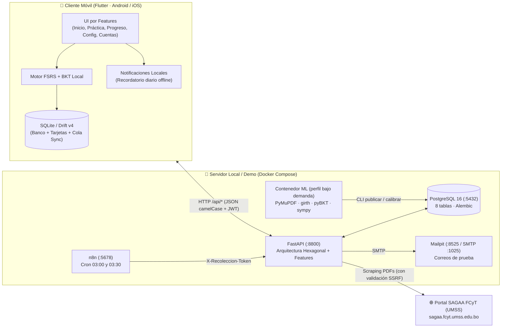
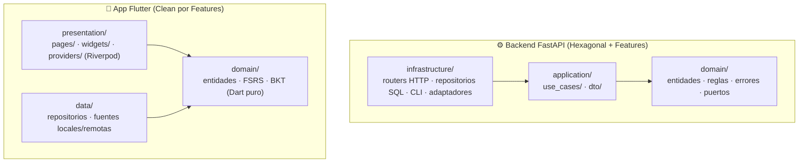
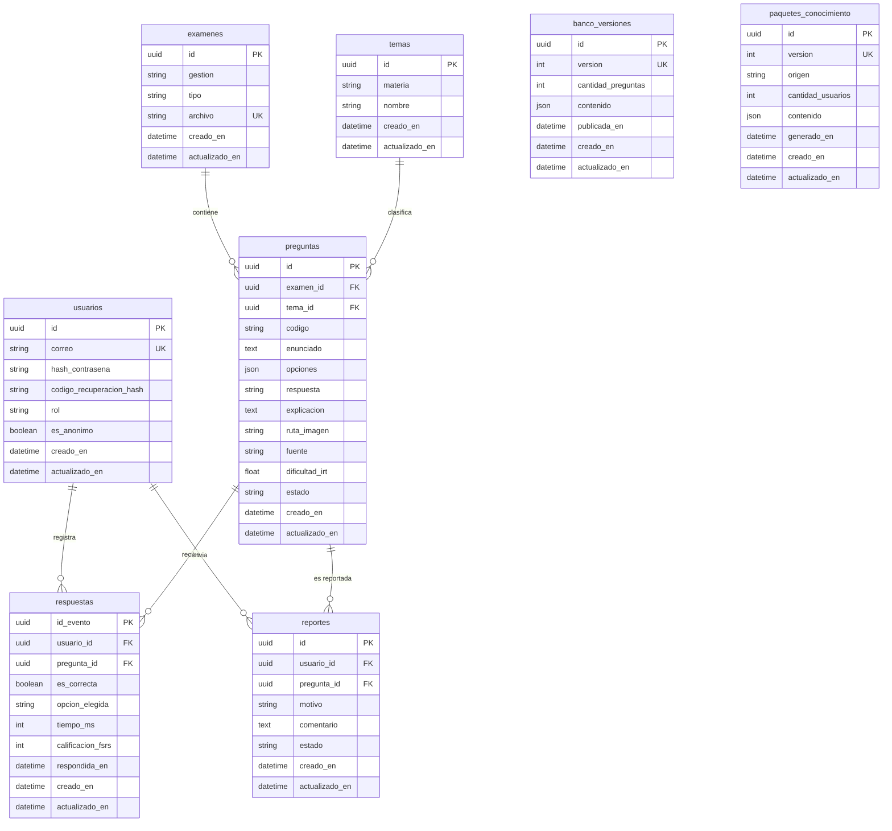
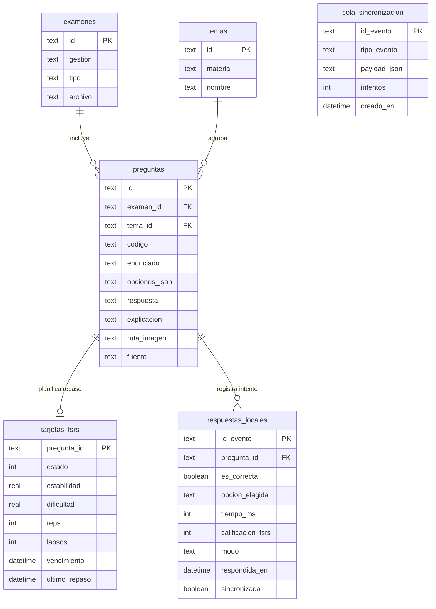
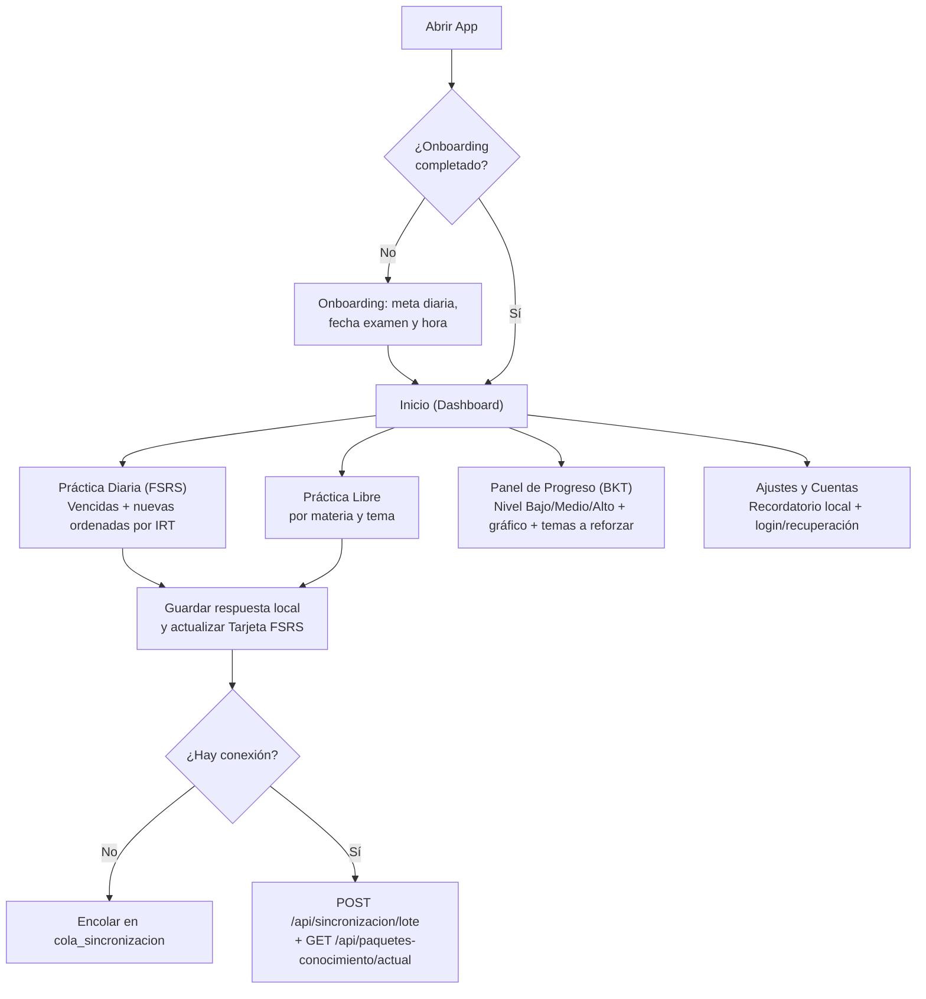

<div align="center">

# ⚡ Prepion

**App móvil gratuita y offline-first para preparar el examen de ingreso a la Facultad de Ciencias y Tecnología (FCyT — UMSS) con preguntas de exámenes reales.**

[](https://github.com/WilHacker/Prepion)
[](#)
[](app/README.md)
[](backend/README.md)
[](docker-compose.yml)
[](docker-compose.yml)

*Cada día te recuerda practicar, repite lo que fallas con repaso espaciado (**FSRS**), estima tu dominio por tema (**BKT**) y calibra la dificultad de las preguntas (**IRT**). Funciona 100 % sin internet.*

</div>

---

## Índice

1. [Cómo iniciar rápido (resumen)](#-1-cómo-iniciar-rápido-resumen)
2. [Qué necesitas instalar](#-2-qué-necesitas-instalar)
3. [Instalación paso a paso desde cero](#-3-instalación-paso-a-paso-desde-cero)
4. [Configuración y puesta en marcha (una sola vez)](#-4-configuración-y-puesta-en-marcha-una-sola-vez)
5. [Arquitectura Cliente–Servidor (Diagramas)](#-5-arquitectura-clienteservidor-diagramas)
6. [Diseño de Bases de Datos (Servidor y Móvil)](#-6-diseño-de-bases-de-datos-servidor-y-móvil)
7. [Flujos del Sistema: App Móvil, Scraping n8n y ML](#-7-flujos-del-sistema-app-móvil-scraping-n8n-y-ml)
8. [Estructura del monorepo](#-8-estructura-del-monorepo)
9. [Trabajar día a día](#-9-trabajar-día-a-día)
10. [Calidad, pruebas y commits](#-10-calidad-pruebas-y-commits)
11. [Solución de problemas](#-11-solución-de-problemas)
12. [Equipo y Autores](#-12-equipo-y-autores)

---

## 🚀 1. Cómo iniciar rápido (resumen)

Si ya tienes las herramientas de la [Sección 2](#-2-qué-necesitas-instalar), levanta todo el entorno local en 5 pasos:

```bash
# 1. Clonar el repositorio
git clone https://github.com/WilHacker/Prepion.git
cd Prepion

# 2. Configurar variables de entorno (.env)
cp .env.example .env
# Edita .env con tus contraseñas, RECOLECCION_TOKEN y JWT_SECRETO

# 3. Instalar hooks/calidad en raíz, dependencias de backend y de app
pnpm install
cd backend && uv sync --all-groups && cd ..
cd app && flutter pub get && cd ..

# 4. Levantar PostgreSQL, migraciones, API, n8n y Mailpit en Docker
docker compose up -d --build

# 5. Verificar que todo compila y pasa pruebas (>= 80 % cobertura)
pnpm run check
```

Luego corre la app móvil en tu emulador o celular desde `app/`:
```bash
cd app
flutter run
# O en celular físico por USB en la misma Wi-Fi:
flutter run --dart-define=API_URL=http://<IP-DE-TU-PC>:8800
```

---

## 🛠️ 2. Qué necesitas instalar

| Herramienta | Versión probada | Para qué se usa |
|---|---|---|
| **Git** | 2.5x | Clonar el repositorio y controlar versiones |
| **Docker Desktop** (con Compose) | Docker 29 · Compose 5 | Correr PostgreSQL, migraciones, API, ML, n8n y Mailpit |
| **Python** | 3.13 | Backend FastAPI y scripts de extracción/ML |
| **uv** | 0.12 | Gestor rápido de entornos y paquetes Python |
| **Node.js** | 22 o superior | Herramientas de calidad del monorepo |
| **pnpm** | 11 | Hooks de Git (`husky`), `lint-staged`, `commitlint` y scripts raíz |
| **Flutter** (incluye Dart) | Flutter 3.50.1 · Dart 3.14 | App móvil multiplataforma (Android / iOS) |
| **Android Studio** | 2026.x | SDK de Android, emulador y herramientas nativas |
| **Componentes Android SDK** | Plataforma **37**, **NDK 28.2.13676358**, Command-line Tools | Compilar el APK para Android |

> Las instrucciones están pensadas para **Windows** (entorno del equipo). En macOS o Linux los pasos y comandos del proyecto son los mismos; solo cambia el gestor de instalación y el `PATH`.

---

## 📦 3. Instalación paso a paso desde cero

Después de instalar cada herramienta, **cierra y vuelve a abrir la terminal** para que reconozca los comandos nuevos.

### 3.1 Git
1. Descarga e instala desde <https://git-scm.com/downloads>.
2. Verifica y configura tu identidad:
```bash
git --version
git config --global user.name "Tu Nombre"
git config --global user.email "tu-correo@ejemplo.com"
```

### 3.2 Docker Desktop
1. Descarga e instala desde <https://www.docker.com/products/docker-desktop/> (en Windows deja activado **WSL 2**).
2. Abre Docker Desktop y espera a que el motor esté en ejecución.
3. Verifica:
```bash
docker --version
docker compose version
```

### 3.3 Python 3.13 y `uv`
1. Instala Python 3.13 desde <https://www.python.org/downloads/> marcando **"Add python.exe to PATH"**.
2. Instala `uv` en PowerShell:
```powershell
powershell -ExecutionPolicy ByPass -c "irm https://astral.sh/uv/install.ps1 | iex"
```
3. Verifica:
```bash
python --version
uv --version
```

### 3.4 Node.js y `pnpm`
1. Instala Node.js (LTS ≥ 22) desde <https://nodejs.org/>.
2. Instala `pnpm` y verifica:
```bash
npm install -g pnpm
node --version
pnpm --version
```

### 3.5 Flutter
1. Clona Flutter estable en tu carpeta de usuario:
```bash
git clone --depth 1 -b stable https://github.com/flutter/flutter.git C:\Users\<tu-usuario>\flutter
```
2. Agrega `flutter\bin` al `PATH` del usuario en PowerShell:
```powershell
[Environment]::SetEnvironmentVariable("Path", [Environment]::GetEnvironmentVariable("Path","User") + ";C:\Users\<tu-usuario>\flutter\bin", "User")
```
3. Abre una terminal nueva y verifica:
```bash
flutter --version
```

### 3.6 Android Studio y componentes del SDK
1. Instala [Android Studio](https://developer.android.com/studio) y ábrelo una vez para descargar el SDK en `C:\Users\<tu-usuario>\AppData\Local\Android\Sdk`.
2. Abre **SDK Manager**:
   - **SDK Platforms:** marca **Android SDK Platform 37** (requerido por `flutter_local_notifications`).
   - **SDK Tools** (marca *Show Package Details*):
     - **Android SDK Command-line Tools (latest)**
     - **NDK (Side by side) → 28.2.13676358**
     - **Android SDK Platform-Tools**
3. Acepta las licencias y verifica el entorno:
```bash
flutter doctor --android-licenses
flutter doctor
```
Debe mostrar `[√]` en **Flutter** y **Android toolchain**.

### 3.7 Emulador o celular físico
- **Emulador:** en Android Studio → *Device Manager → Create Device*, elige un teléfono e imagen reciente y arráncalo.
- **Celular físico:** activa *Opciones de desarrollador → Depuración por USB*, conéctalo por cable y confirma con:
```bash
flutter devices
```

---

## ⚙️ 4. Configuración y puesta en marcha (una sola vez)

### 4.1 Variables de entorno (`.env`)
Copia la plantilla y personaliza los secretos:
```bash
cp .env.example .env
```

| Variable | Obligatoria | Descripción |
|---|---|---|
| `POSTGRES_USER` | Sí | Usuario de PostgreSQL (por defecto `prepion`) |
| `POSTGRES_PASSWORD` | Sí | Contraseña de PostgreSQL (úsalas igual en `DATABASE_URL`) |
| `POSTGRES_DB` | Sí | Nombre de la base de datos (`prepion`) |
| `DATABASE_URL` | Sí (local) | Cadena SQLAlchemy/psycopg para correr el backend desde la PC; Docker Compose la arma internamente |
| `RECOLECCION_TOKEN` | Para n8n/ML | Token que protege `POST /api/examenes/recolectar` y `POST /api/conocimiento/recalibrar` |
| `EXAMENES_PDF_DIR` | Opcional | Carpeta local de PDF descargados (`../data/examenes_pdf` en PC; `/srv/data/examenes_pdf` en Docker) |
| `JWT_SECRETO` | Sí (auth) | Secreto largo (≥ 32 caracteres) para firmar tokens JWT de sesión |
| `ADMIN_CORREO` / `ADMIN_CONTRASENA` | Para admin | Credenciales iniciales para crear la cuenta administradora con `pnpm run admin:crear` |

> `.env` **nunca** se sube a Git (está en `.gitignore`). Puedes generar tokens seguros con:
> `python -c "import secrets; print(secrets.token_urlsafe(32))"`

### 4.2 Levantar servicios en Docker y verificar puertos
```bash
docker compose up -d --build
```
Esto levanta en orden: **`postgres`** → **`migrate`** (Alembic `upgrade head`) → **`api`**, junto con **`n8n`** y **`mailpit`**.

| Servicio | URL / Puerto | Propósito |
|---|---|---|
| **API FastAPI** | <http://localhost:8800/api/health> | Healthcheck (`{"estado":"ok"}`) |
| **Swagger / OpenAPI** | <http://localhost:8800/docs> | Documentación interactiva de endpoints |
| **n8n** | <http://localhost:5678> | Automatización diaria de scraping (03:00) y recalibración ML (03:30) |
| **Mailpit** | <http://localhost:8525> (SMTP `1025`) | Bandeja local para correos de verificación/recuperación |
| **PostgreSQL 16** | `localhost:5432` | Base de datos relacional del servidor |

> **Nota sobre puertos en Windows:** Hyper-V/Windows suele reservar el rango `7966–8065` (que incluye `8000` y `8025`). Por eso la API expone **`8800`** y Mailpit **`8525`**.

### 4.3 Cargar flujos de n8n y cuenta admin (opcional)
```bash
# Importar y activar los flujos de n8n (recolección y recalibración ML)
pnpm run n8n:importar

# Crear cuenta administradora definida en .env
pnpm run admin:crear
```

---

## 🏗️ 5. Arquitectura Cliente–Servidor (Diagramas)

Prepion sigue una arquitectura **offline-first híbrida**: el celular ejecuta la práctica, el algoritmo **FSRS** y el cálculo local **BKT** sin conexión; el servidor **FastAPI + PostgreSQL + n8n** centraliza cuentas, banco oficial, sincronización en lote y recalibración **IRT** del modelo de conocimiento.

### 5.1 Vista general Cliente–Servidor e Infraestructura Docker



### 5.2 Capas internas: Backend Hexagonal vs. App por Features



---

## 🗄️ 6. Diseño de Bases de Datos (Servidor y Móvil)

### 6.1 Base de datos del Servidor — PostgreSQL 16 (8 tablas, Alembic)



### 6.2 Base de datos Local del Móvil — SQLite / Drift (`schemaVersion = 4`, 6 tablas)



---

## 🔄 7. Flujos del Sistema: App Móvil, Scraping n8n y ML

### 7.1 Flujo del Estudiante en la App (Offline-First + Sync)



### 7.2 Pipeline de Datos, Scraping y Recalibración ML

```mermaid
flowchart LR
    P1["1. Portal SAGAA FCyT<br/>(PDFs oficiales)"] -->|"n8n 03:00 / POST /api/examenes/recolectar"| P2["2. Descarga segura<br/>data/examenes_pdf/"]
    P2 -->|"CLI extraer (PyMuPDF)"| P3["3. Borrador CSV +<br/>imágenes PNG fórmulas"]
    P3 -->|"Curación manual<br/>(doble verificación)"| P4["4. CSV estado=publicada"]
    P4 -->|"CLI exportar / publicar"| P5["5. banco_semilla.json<br/>+ PostgreSQL banco_versiones"]
    P5 -->|"n8n 03:30 / POST /api/conocimiento/recalibrar<br/>(IRT Rasch 1PL + BKT)"| P6["6. Paquete Conocimiento<br/>GET /api/paquetes-conocimiento/actual"]
```



---

## 📁 8. Estructura del monorepo

```text
Prepion/
├── app/                         App móvil en Flutter (ver app/README.md)
│   ├── lib/
│   │   ├── main.dart            Arranque: ProviderScope + sobrescrituras + notificaciones
│   │   ├── app/                 prepion_app.dart, router.dart, theme.dart, integracion_preferencias.dart
│   │   ├── shared/              config/, network/ (Dio), database/ (Drift v4), notifications/
│   │   └── features/            inicio · configuracion · practica · progreso · conocimiento · cuentas · sincronizacion
│   ├── assets/datos/            banco_semilla.json y parametros_conocimiento.json embebidos
│   ├── assets/imagenes/         Fórmulas y gráficos recortados de exámenes reales
│   └── test/                    Espejo de lib/
├── backend/                     API en FastAPI + PostgreSQL + ML (ver backend/README.md)
│   ├── app/
│   │   ├── main.py              create_app() y routers /api/*
│   │   ├── core/                config.py, database.py, errors.py (RFC 9457), models.py
│   │   ├── shared/              DominioError, TablaBase (UUID + timestamps)
│   │   └── features/            health · auth · cuentas · configuracion · examenes · preguntas · conocimiento · sincronizacion · reportes
│   ├── migrations/              Alembic (versions/)
│   └── tests/                   Espejo de app/
├── n8n/flujos/                  Flujos exportados de recolección y recalibración
├── data/                        PDFs, borradores CSV e imágenes locales (no versionados)
├── docs/                        ESTANDARES.md, HISTORIAS_DE_USUARIO.md, brand_ui_design_system_skill.md
├── scripts/                     verificar-cobertura.mjs
├── docker-compose.yml           postgres, migrate, api, ml (perfil), n8n, mailpit
├── package.json                 Scripts pnpm, husky, lint-staged, commitlint, commitizen
└── .env.example                 Plantilla de variables de entorno
```

---

## 📅 9. Trabajar día a día

| Tarea | Comando |
|---|---|
| Levantar los servicios | `docker compose up -d` |
| Detener servicios | `docker compose stop` |
| Ver logs de la API | `docker compose logs -f api` |
| Reconstruir tras cambiar dependencias del backend | `docker compose up -d --build` |
| Correr la app en emulador | `cd app && flutter run` |
| Correr la app en celular físico | `cd app && flutter run --dart-define=API_URL=http://<IP-de-tu-PC>:8800` |
| Tareas de ML bajo demanda | `docker compose run --rm ml <comando>` |
| Borrar BD local y empezar de cero | `docker compose down -v` *(⚠️ elimina datos locales)* |

---

## ✅ 10. Calidad, pruebas y commits

El repositorio exige calidad automática antes de subir cambios (no usar `--no-verify`):

| Momento | Qué se ejecuta |
|---|---|
| `git commit` | `lint-staged` formatea/lintea archivos modificados (`ruff` / `dart format`) y `commitlint` valida el mensaje |
| `git push` | `pnpm run check`: formato, lint, tipos (`mypy`, `flutter analyze --fatal-infos`) y pruebas con **cobertura ≥ 80 %** |
| GitHub Actions | CI completa en PR y `main`, incluyendo pruebas de migraciones Alembic sobre PostgreSQL |

```bash
# Verificar todo en local antes de subir
pnpm run check

# Commit guiado (Conventional Commits en español y minúsculas)
git add <archivos>
pnpm run commit
```
Alcances permitidos: `app`, `backend`, `ml`, `docker`, `ci`, `docs`, `deps`.

---

## 🔧 11. Solución de problemas

| Síntoma | Solución |
|---|---|
| Docker falla en puerto `8000` o `8025` | Windows/Hyper-V reserva puertos (`7966–8065`). Usa **`8800`** (API) y **`8525`** (Mailpit) |
| `flutter` o `adb` no reconocido en terminal | Cierra y reabre la terminal/editor tras editar el `PATH` |
| APK falla pidiendo NDK `28.2.13676358` o SDK `37` | Instalarlos en Android Studio → *SDK Manager* (ver [3.6](#36-android-studio-y-componentes-del-sdk)) |
| `flutter analyze` falla por paquetes faltantes | Corre `cd app && flutter pub get` en tu terminal local |
| Error `DATABASE_URL` al iniciar backend | Verifica `.env` en la raíz con `cp .env.example .env` |
| `POST /api/examenes/recolectar` responde `503` | Define `RECOLECCION_TOKEN` en `.env` y reinicia el contenedor `api` |

---

## 👥 12. Equipo y Autores

Proyecto desarrollado para la **Hackatón Abstracthon 2026** (Track 02 · Educación) por el equipo **GrandTheftCode**:

| Integrante | GitHub | Áreas principales |
|---|---|---|
| **Willian Andres Almendras Calizaya** | [@WilHacker](https://github.com/WilHacker) | Arquitectura del monorepo, extractor PDF/curación (#1), práctica diaria FSRS (#3), panel BKT/IRT (#6), scraping/n8n |
| **Camilo Baltazar Nogales Fuentes** | [@camilonogales96](https://github.com/camilonogales96) | Onboarding y configuración de metas (#2), design system/tema, recordatorios diarios offline (#4) |
| **Giuliana Quispe Salazar** | [@giulilvsmrk](https://github.com/giulilvsmrk) | Práctica libre por materia y tema (#5) |
| **Alejandro Rayner Illanes** | [@alejandroRaynerIllanes](https://github.com/alejandroRaynerIllanes) | Design system (`brand_ui_design_system_skill.md`), cuentas y autenticación JWT (#7 / #11) |
| **Jhoan Mijael Claure Rodriguez** | [@jhoanclaure](https://github.com/jhoanclaure) | Sincronización bidireccional offline-first (#8) y sistema de reporte de errores (#9) |

---

## 📚 Documentación adicional

- [`backend/README.md`](backend/README.md) — API, endpoints, migraciones Alembic, scraping y pipeline ML
- [`app/README.md`](app/README.md) — App Flutter, Drift v4, compilación APK y paquetes
- [`docs/ESTANDARES.md`](docs/ESTANDARES.md) — Estándares de código, idioma híbrido y arquitectura
- [`docs/HISTORIAS_DE_USUARIO.md`](docs/HISTORIAS_DE_USUARIO.md) — Historias de usuario, contrato API y backlog
