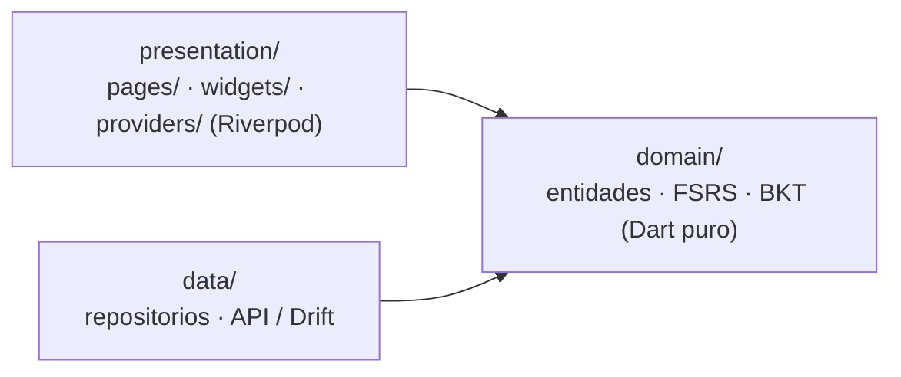
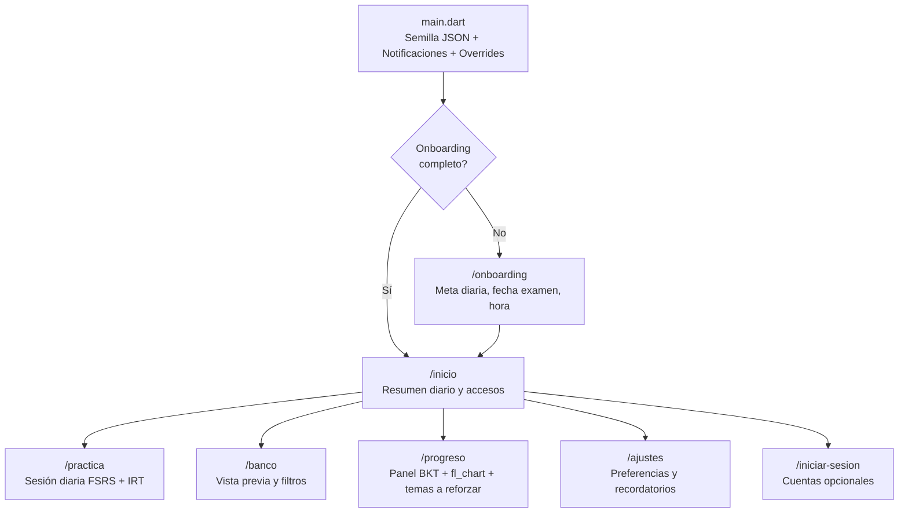
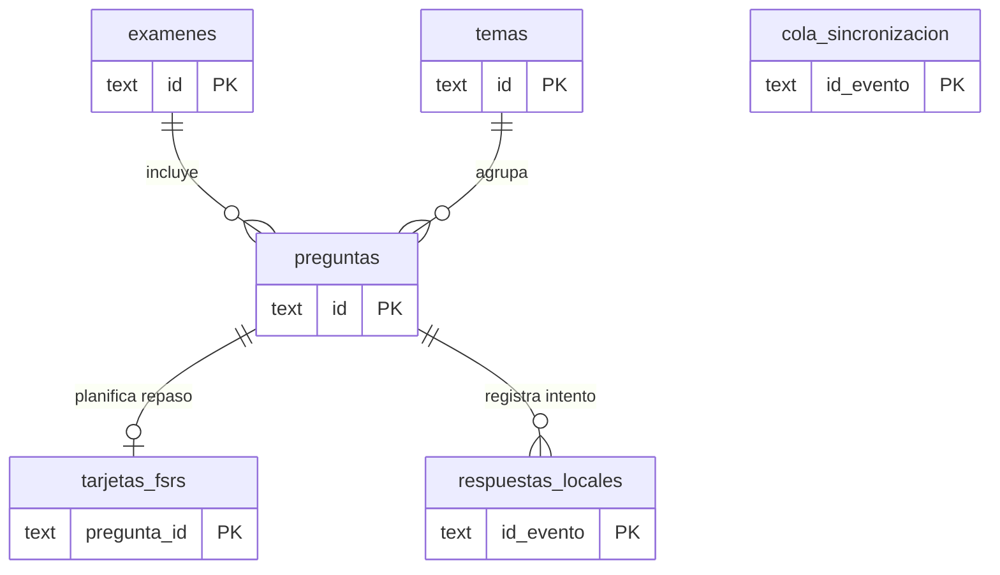

<div align="center">

# 📱 Prepion — App móvil (Flutter)

[](https://flutter.dev/)
[](https://dart.dev/)
[](https://drift.simonbinder.eu/)

App móvil **offline-first** para preparación diaria al examen de ingreso a la FCyT (UMSS). El banco de preguntas, la programación **FSRS**, el cálculo de dominio **BKT**, las notificaciones y la cola de sincronización viven en el celular. Antes de empezar, sigue la instalación del [README general](../README.md).

</div>

---

## Índice
1. [Cómo iniciar primero](#1-cómo-iniciar-primero)
2. [Requisitos y configuración de red](#2-requisitos-y-configuración-de-red)
3. [Correr y compilar APK](#3-correr-y-compilar-apk)
4. [Arquitectura por features y flujo de pantallas](#4-arquitectura-por-features-y-flujo-de-pantallas)
5. [Base de datos local (Drift v4)](#5-base-de-datos-local-drift-v4)
6. [Cómo agregar algo nuevo](#6-cómo-agregar-algo-nuevo)
7. [Pruebas y calidad](#7-pruebas-y-calidad)
8. [Configuración de Android](#8-configuración-de-android)
9. [Paquetes principales](#9-paquetes-principales)

---

## 1. Cómo iniciar primero

```bash
# 1. Asegura que el backend está corriendo (desde la raíz):
docker compose up -d

# 2. Instala paquetes de Flutter (desde app/):
cd app
flutter pub get

# 3. Verifica el entorno y corre en emulador:
flutter doctor
flutter run
```

---

## 2. Requisitos y configuración de red

| Herramienta | Versión |
|---|---|
| Flutter (incluye Dart) | 3.50.1 · Dart 3.14 |
| Android Studio + SDK | Plataforma **37**, **NDK 28.2.13676358**, Command-line Tools, licencias aceptadas |
| Emulador o celular Android | Depuración por USB activada si es físico |

### URL del backend (`--dart-define=API_URL=...`)

| Dónde corre la app | Valor por defecto / parámetro |
|---|---|
| **Emulador Android** | Sin flags: usa `http://10.0.2.2:8800` por defecto |
| **Celular físico** | `--dart-define=API_URL=http://<IP-DE-TU-PC>:8800` (misma Wi-Fi) |
| **Demo (túnel)** | `--dart-define=API_URL=https://<url-del-tunel>` |

Configurado en `lib/shared/config/app_config.dart`; el cliente Dio (`lib/shared/network/api_client.dart`) añade el prefijo `/api`.

---

## 3. Correr y compilar APK

| Acción | Comando (desde `app/`) | Resultado / Nota |
|---|---|---|
| Correr en emulador | `flutter run` | `r` hot reload · `R` hot restart · `q` salir |
| Correr en celular físico | `flutter run --dart-define=API_URL=http://<IP>:8800` | Ver dispositivos con `flutter devices` |
| Compilar APK Debug | `flutter build apk --debug` | `build/app/outputs/flutter-apk/app-debug.apk` |
| Compilar APK Release | `flutter build apk --release` | `build/app/outputs/flutter-apk/app-release.apk` |

> **iOS:** el mismo código sirve para iPhone, pero compilarlo requiere macOS y Xcode.

---

## 4. Arquitectura por features y flujo de pantallas





- **Features actuales:** `inicio`, `configuracion`, `practica`, `progreso`, `conocimiento`, `cuentas`, `sincronizacion`.
- **Aislamiento:** una feature no importa el interior de otra; la integración transversal entre `configuracion`, `practica` y `progreso` vive en `lib/app/integracion_preferencias.dart` y se inyecta en `main.dart`.

---

## 5. Base de datos local (Drift v4)

Definida en `lib/shared/database/app_database.dart` (`schemaVersion = 4`):



Al modificar tablas o modelos anotados:
1. Sube `schemaVersion` en `app_database.dart` y agrega el paso en `onUpgrade`.
2. Regenera el código (y súbelo a Git):
```bash
dart run build_runner build --delete-conflicting-outputs
```

---

## 6. Cómo agregar algo nuevo

- **Pantalla:** `lib/features/<feature>/presentation/pages/<nombre>_page.dart` → ruta en `lib/app/router.dart` → prueba en `test/features/<feature>/presentation/pages/`.
- **Regla de negocio:** Dart puro en `lib/features/<feature>/domain/` → prueba unitaria en `test/features/<feature>/domain/`.
- **Llamada al backend:** en `lib/features/<feature>/data/` usando `clienteApiProvider`.

---

## 7. Pruebas y calidad

| Comando | Qué hace |
|---|---|
| `flutter test` | Pruebas unitarias y de widgets |
| `flutter test --coverage` | Genera `coverage/lcov.info` |
| `dart format lib test` | Formatea el código Dart |
| `flutter analyze --fatal-infos` | Análisis estricto (cualquier aviso falla) |
| `pnpm run test:app` *(desde raíz)* | Ejecuta pruebas y exige **cobertura ≥ 80 %** |

---

## 8. Configuración de Android

| Archivo | Configuración | Motivo |
|---|---|---|
| `android/app/build.gradle.kts` | `compileSdk` ≥ 37, desugaring y `multiDexEnabled` | Exigido por `flutter_local_notifications` 23 |
| `android/app/src/main/AndroidManifest.xml` | `INTERNET`, `POST_NOTIFICATIONS`, `RECEIVE_BOOT_COMPLETED` + receptores | Red, notificaciones Android 13+ y reprogramación tras reinicio |
| `android/app/src/debug/AndroidManifest.xml` | `usesCleartextTraffic="true"` | HTTP local hacia la PC solo en debug |

---

## 9. Paquetes principales

| Paquete | Uso |
|---|---|
| `go_router`, `flutter_riverpod` | Navegación y gestión de estado |
| `drift`, `drift_flutter`, `shared_preferences` | SQLite local y preferencias simples |
| `flutter_local_notifications`, `timezone`, `flutter_timezone` | Recordatorios diarios offline |
| `fsrs`, `fl_chart` | Repaso espaciado y gráficos de progreso |
| `dio`, `connectivity_plus`, `flutter_secure_storage`, `uuid` | Red, conectividad, almacenamiento cifrado e IDs |
| `json_annotation`, `freezed_annotation`, `build_runner`, `drift_dev` | Modelos inmutables y generación de código |
