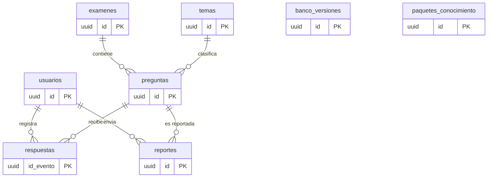
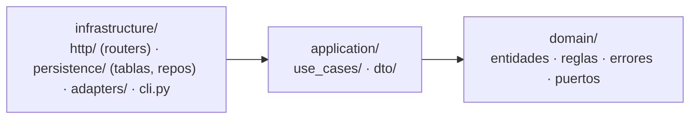

<div align="center">

# ⚙️ Prepion — Backend & ML

[](https://fastapi.tiangolo.com/)
[](https://www.python.org/)
[](https://www.postgresql.org/)
[](https://docs.astral.sh/uv/)

API REST en **FastAPI + PostgreSQL 16 + Alembic** bajo arquitectura **hexagonal por features**, y pipeline de **extracción PDF, scraping SAGAA y calibración ML (IRT + BKT)**. Antes de empezar, revisa la instalación base en el [README general](../README.md).

</div>

---

## Índice
1. [Cómo iniciar primero](#1-cómo-iniciar-primero)
2. [Requisitos y variables de entorno](#2-requisitos-y-variables-de-entorno)
3. [Correr el backend](#3-correr-el-backend)
4. [Endpoints disponibles (`/api/*`)](#4-endpoints-disponibles-api)
5. [Diseño de Base de Datos (PostgreSQL + Alembic)](#5-diseño-de-base-de-datos-postgresql--alembic)
6. [Arquitectura: hexagonal + features](#6-arquitectura-hexagonal--features)
7. [Cómo agregar algo nuevo](#7-cómo-agregar-algo-nuevo)
8. [Pruebas y calidad](#8-pruebas-y-calidad)
9. [ML, scraping y extracción de exámenes](#9-ml-scraping-y-extracción-de-exámenes)
10. [Dependencias](#10-dependencias)

---

## 1. Cómo iniciar primero

```bash
# Desde la raíz del repo:
cp .env.example .env            # Configura contraseñas, RECOLECCION_TOKEN y JWT_SECRETO
docker compose up -d --build    # Levanta postgres -> api (:8800, migra al arrancar). n8n es opcional: --profile automatizacion

# Instalar dependencias locales (para CLI, pruebas y lint desde la PC):
cd backend
uv sync --all-groups
uv run pytest
```

Verifica que la API responde en <http://localhost:8800/api/health> (`{"estado":"ok"}`) y explora Swagger en <http://localhost:8800/docs>.

---

## 2. Requisitos y variables de entorno

| Herramienta | Versión |
|---|---|
| Python | 3.13 |
| uv | 0.12 |
| Docker Desktop | Para PostgreSQL, API (con migraciones), ML y n8n (opcional) |

El backend lee el `.env` de la **raíz del repo** (o `backend/.env`):

| Variable | Obligatoria | Uso |
|---|---|---|
| `DATABASE_URL` | Sí | `postgresql+psycopg://prepion:<clave>@localhost:5432/prepion` (en Docker la arma `docker-compose.yml`) |
| `JWT_SECRETO` | Sí (auth/cuentas) | Secreto ≥ 32 chars para firmar tokens JWT |
| `RECOLECCION_TOKEN` | Para scraping/ML | Token exigido en cabecera `X-Recoleccion-Token` por n8n |
| `EXAMENES_PDF_DIR` | Opcional | Carpeta de PDF (`../data/examenes_pdf` local; `/srv/data/examenes_pdf` en Docker) |
| `ADMIN_CORREO` / `ADMIN_CONTRASENA` | Para admin | Usados por `pnpm run admin:crear` |

---

## 3. Correr el backend

### Opción A: todo en Docker (recomendada)
```bash
docker compose up -d --build
```
`api` aplica las migraciones pendientes de Alembic al arrancar y luego sirve en <http://localhost:8800>.

### Opción B: en tu PC con recarga automática
Con PostgreSQL levantado (`docker compose up -d postgres`) y migraciones aplicadas (`uv run alembic upgrade head`):
```bash
cd backend
uv run uvicorn app.main:app --reload --port 8800
```

> Se usa el puerto **8800** porque Windows/Hyper-V reserva el rango `7966–8065` (incluyendo `8000`).

---

## 4. Endpoints disponibles (`/api/*`)

| Feature | Método y Ruta | Acceso | Propósito |
|---|---|---|---|
| `health` | `GET /api/health` | Público | Estado del servicio |
| `configuracion` | `GET /api/parametros-publicos` | Público | Fechas tentativas de examen y metas diarias |
| `preguntas` | `GET /api/preguntas/banco/actual` | Público | Metadatos de la última versión publicada del banco |
| `preguntas` | `GET /api/preguntas/banco/descargar/{version}` | Público | Descarga el JSON completo del banco |
| `preguntas` | `GET /api/temas`, `GET /api/preguntas` | Público | Consulta de temas y preguntas por filtro |
| `conocimiento` | `GET /api/paquetes-conocimiento/actual` | Público | Último paquete IRT/BKT calibrado |
| `conocimiento` | `POST /api/conocimiento/recalibrar` | `X-Recoleccion-Token` | Recalibra dificultad IRT + BKT y publica nueva versión |
| `examenes` | `POST /api/examenes/recolectar` | `X-Recoleccion-Token` | Scraping seguro del portal SAGAA FCyT |
| `sincronizacion` | `POST /api/sincronizacion/lote` | Usuario | Sincroniza respuestas en lote sin duplicar (`idEvento`) |
| `cuentas` | `POST /api/auth/registro`, `POST /api/auth/login`, `GET /api/auth/yo` | Público / Bearer | Registro, inicio de sesión JWT y perfil |
| `cuentas` | `GET /api/admin/usuarios` | Admin Bearer | Gestión de usuarios |

---

## 5. Diseño de Base de Datos (PostgreSQL + Alembic)



### Comandos Alembic (desde `backend/`)

| Paso | Comando |
|---|---|
| Generar migración | `uv run alembic revision --autogenerate -m "descripcion"` |
| Aplicar migraciones | `uv run alembic upgrade head` |
| Verificar sincronización modelos/BD | `uv run alembic check` |
| Revertir última migración | `uv run alembic downgrade -1` |
| Ver historial | `uv run alembic history` |

> **Regla:** nunca editar una migración ya aplicada; toda migración debe implementar `downgrade()`.

---

## 6. Arquitectura: hexagonal + features



- **Features actuales:** `health`, `auth`, `cuentas`, `configuracion`, `examenes`, `preguntas`, `conocimiento`, `sincronizacion`, `reportes`.
- **Errores de dominio (`shared/domain/errores.py`):** se convierten automáticamente en `application/problem+json` (RFC 9457) en `core/errors.py` (`404`, `409`, `422`, etc.).
- **Idioma híbrido:** dominio en español (`obtener_preguntas`, `PreguntaTabla`), estructura técnica en inglés (`../docs/ESTANDARES.md`).

---

## 7. Cómo agregar algo nuevo

- **Endpoint:** caso de uso en `application/use_cases/` → puerto en `domain/` y adaptador en `infrastructure/persistence/` → router en `infrastructure/http/router.py` → registrar en `create_app()` (`app/main.py`) con `prefix="/api"` → pruebas en `tests/features/<feature>/`.
- **Tabla:** modelo `<Entidad>Tabla(TablaBase, table=True)` en `infrastructure/persistence/tablas.py` → importar en `app/core/models.py` → generar y aplicar migración Alembic.

---

## 8. Pruebas y calidad

| Comando (desde `backend/`) | Qué hace |
|---|---|
| `uv run pytest` | Pruebas con cobertura (`--cov-fail-under=80`) |
| `uv run ruff format .` | Formateo automático |
| `uv run ruff check .` | Lint (imports, convenciones, seguridad) |
| `uv run mypy` | Verificación estricta de tipos |

---

## 9. ML, scraping y extracción de exámenes

Las tareas pesadas usan el grupo `ml` (`docker compose run --rm ml <comando>` o `uv run --group ml python ...`):

1. **Listar/descargar PDFs:** `uv run --group ml python -m app.features.examenes.infrastructure.cli descargar ../data/examenes_pdf --gestion 2-2026`
2. **Extraer a CSV + PNGs:** `uv run python -m app.features.examenes.infrastructure.cli extraer ../data/examenes_pdf/2026-2-2op.pdf ../data/borradores/2026-2-2op.csv --imagenes ../data/imagenes`
3. **Curar CSV** (doble revisión humana) → `estado = publicada`
4. **Exportar semilla JSON:** `uv run python -m app.features.examenes.infrastructure.cli exportar ../data/borradores/2026-2-2op.csv ../app/assets/datos/banco_semilla.json --examen 2026-2-2op.pdf --copiar-imagenes ../data/imagenes ../app/assets/imagenes`
5. **Publicar en servidor:** `uv run python -m app.features.preguntas.infrastructure.cli publicar ../app/assets/datos/banco_semilla.json`
6. **Calibrar IRT + BKT:** `uv run --group ml python -m app.features.conocimiento.infrastructure.cli simular-y-calibrar --banco ../app/assets/datos/banco_semilla.json --salida ../data/parametros_conocimiento_v1.json`

> `scikit-learn` está fijado en `<1.8` por compatibilidad con `pyBKT`.

---

## 10. Dependencias

| Grupo | Paquetes principales |
|---|---|
| Principal | `fastapi`, `uvicorn[standard]`, `sqlmodel`, `psycopg[binary]`, `alembic`, `pydantic-settings`, `argon2-cffi`, `pyjwt`, `slowapi`, `email-validator` |
| `dev` | `pytest`, `pytest-cov`, `httpx2`, `ruff`, `mypy` |
| `ml` | `pymupdf`, `requests`, `beautifulsoup4`, `pyBKT`, `girth`, `fsrs`, `numpy`, `pandas`, `scipy`, `sympy`, `matplotlib`, `scikit-learn<1.8` |
